<picture>
  <source media="(prefers-color-scheme: dark)" srcset="https://raw.githubusercontent.com/sid-newby/sid-newby/cards/about-dark.svg">
  
</picture>
<picture>
  <source media="(prefers-color-scheme: dark)" srcset="https://raw.githubusercontent.com/sid-newby/sid-newby/cards/featured-dark.svg">
  
</picture>

<picture>
  <source media="(prefers-color-scheme: dark)" srcset="https://raw.githubusercontent.com/sid-newby/sid-newby/cards/summary-dark.svg">
  
</picture>
<picture>
  <source media="(prefers-color-scheme: dark)" srcset="https://raw.githubusercontent.com/sid-newby/sid-newby/cards/languages-dark.svg">
  
</picture>

<picture>
  <source media="(prefers-color-scheme: dark)" srcset="https://raw.githubusercontent.com/sid-newby/sid-newby/cards/weekly-dark.svg">
  
</picture>
<picture>
  <source media="(prefers-color-scheme: dark)" srcset="https://raw.githubusercontent.com/sid-newby/sid-newby/cards/streaks-dark.svg">
  
</picture>

<a href="https://sidnewby.com">sidnewby.com</a>

